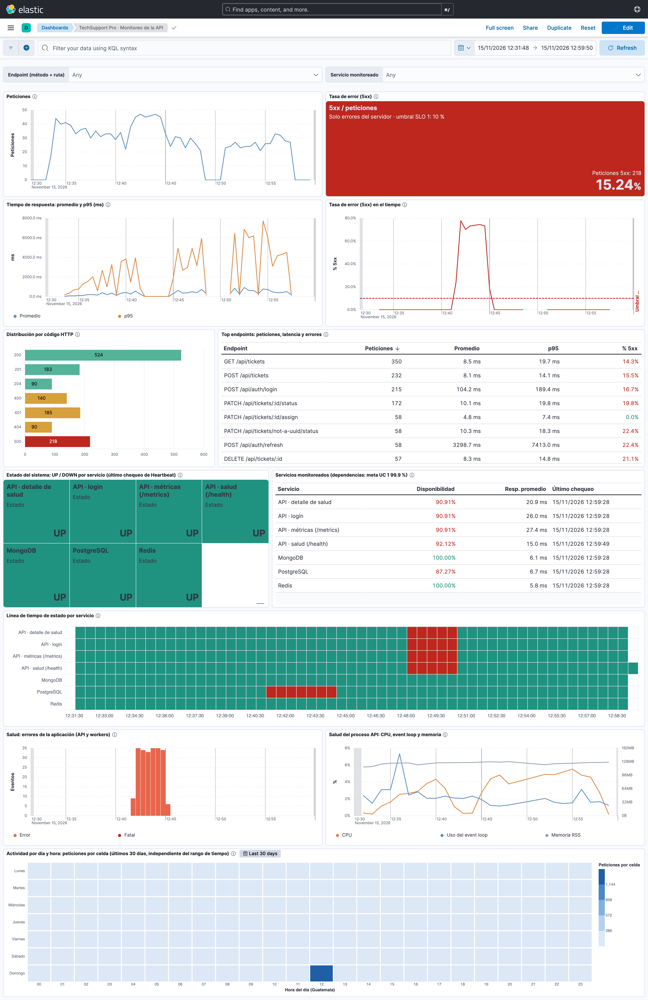

# Fase 3 · Dashboard de monitoreo en Kibana

Sección del informe técnico sobre el dashboard **«TechSupport Pro · Monitoreo de la API»**: qué muestra, de dónde salen los datos, cómo se relaciona con los requisitos del enunciado y con los SLO de la Fase 1, y qué se observó en una corrida de demostración con carga e incidentes provocados.



## 1. Propósito y uso

El dashboard es la pantalla de trabajo del personal de soporte. Responde en un vistazo tres preguntas: **¿está arriba el sistema?**, **¿está fallando la API?** y **¿está lenta?**

- URL: `http://localhost:5601/app/dashboards#/view/techsupport-monitoring`. Se importa solo al levantar el stack (`docker compose up -d --build`, servicio `elk-setup`).
- **Tiempo real.** Rango por defecto «últimos 30 minutos» con refresco automático cada 30 s. Las horas se muestran en hora de Guatemala (UTC−6).
- **Colores.** Verde = bien, ámbar = errores del cliente (4xx), rojo = errores del servidor (5xx) o servicio caído (DOWN).
- **Filtros.** El control *Endpoint (método + ruta)*, la barra de búsqueda (KQL) y los clics en un gráfico filtran los paneles de la API. Los paneles de estado (Heartbeat y salud del proceso) **siempre muestran el estado global**: no les afectan la búsqueda ni los filtros, así que buscar `http.response.status_code >= 500` no oculta qué servicio está caído.
- Cada panel tiene un ícono ⓘ con la pregunta de soporte que responde.
- **Huecos.** Un hueco en una serie significa que no hubo peticiones en ese intervalo, no que el valor fuera 0. Si toda la API está caída, la evidencia está en los paneles de Heartbeat.

## 2. Fuentes de datos

| Fuente | Flujo | Índice / data view |
|---|---|---|
| Logs de la API | La API escribe logs JSON en formato ECS con pino en `logs/app.log`, Filebeat los lee y los envía a Elasticsearch | `logs-techsupport-api-AAAA.MM.DD` · data view «TechSupport · logs de la API» |
| Heartbeat | 8 monitores: 4 HTTP sobre la API (`/health` cada 10 s; `/health/metrics`, `/metrics` y `POST /api/auth/login` cada 30 s), 3 TCP sobre PostgreSQL, Redis y MongoDB, y 1 HTTP sobre Filebeat (`:5066`) para saber si los logs se están enviando (cada 30 s) | data stream `heartbeat-8.15.3` · data view «TechSupport · Heartbeat» |
| Métricas del proceso | La API registra cada 60 s una línea `process_metrics` con CPU, uso del event loop y memoria RSS | mismo índice de logs |

Cada petición HTTP queda registrada con los campos que pide el enunciado: `@timestamp`, `http.request.method`, `http.response.status_code`, `event.duration` (en nanosegundos; el dashboard lo muestra en ms), `url.path`, `service.name` y `log.level`. También guarda `user_agent.original` y `trace.id`.

**Tráfico real.** Los paneles de la API excluyen las sondas, para que no inflen el tráfico ni la tasa de error. La consulta común es:

```
event.action:"http_request" and not http.request.method:"OPTIONS"
and not url.path:("/health" or "/health/metrics" or "/metrics")
and not user_agent.original:Elastic-Heartbeat*
```

**Campos calculados (runtime fields).** Se definen en los data views y no requieren cambiar la API:

- `endpoint` agrupa las rutas con identificadores. Por ejemplo, `/api/tickets/<uuid>/status` se cuenta como `PATCH /api/tickets/:id/status`.
- `hora_del_dia` y `dia_semana` (en hora de Guatemala) alimentan el heatmap de actividad.
- `servicio`, `estado` y `servicio_codigo` dan nombre en español a cada monitor de Heartbeat y su estado UP/DOWN.

## 3. Catálogo de paneles

| Panel | Pregunta que responde | Consulta / cálculo | Unidad |
|---|---|---|---|
| **Peticiones** (`ts-total-requests`) | ¿Cuántas peticiones reales recibe la API y cómo evoluciona la carga? | `count()` sobre tráfico real, en el tiempo | peticiones |
| **Tasa de error (5xx)** (`ts-error-rate-metric`) | ¿Qué porcentaje de peticiones reales falló por culpa del servidor? | `count(kql='http.response.status_code >= 500') / count()`. Se pone en rojo por encima del 10 % (umbral del SLO 1) | % |
| **Tiempo de respuesta: promedio y p95** (`ts-avg-response-time`) | ¿La latencia está estable o se está degradando? | `average(event.duration)` y `percentile(event.duration, 95)` | ms |
| **Tasa de error (5xx) en el tiempo** (`ts-error-rate-time`) | ¿Cuándo empezaron a fallar las peticiones? | La misma fórmula por intervalo, con línea de referencia en 10 % | % |
| **Distribución por código HTTP** (`ts-http-status`) | ¿Qué códigos devuelve la API y en qué proporción? | `count()` por `http.response.status_code`, coloreado por clase (2xx, 4xx, 5xx) | peticiones |
| **Top endpoints** (`ts-tabla-endpoints`) | ¿Qué operaciones concentran el tráfico y cuál es lenta o falla? | Por `endpoint`: peticiones, promedio, p95 y % de 5xx | peticiones / ms / % |
| **Estado del sistema: UP/DOWN por servicio** (`ts-monitor-tiles`) | ¿Qué servicio está caído ahora mismo? Último valor de `summary.up` **en el último minuto** por monitor; verde = UP, rojo = DOWN, **N/A = Heartbeat no reportó** (nunca un UP viejo) | estado |
| **Servicios monitoreados** (`ts-monitor-status`) | ¿Qué dependencia incumple el 99.9 % de UC 1 y cuánto tarda cada servicio? | Por monitor: `average(summary.up)`, `average(monitor.duration.us)` y el último chequeo. El nombre se pone en rojo si está DOWN | % / ms |
| **Línea de tiempo de estado por servicio** (`ts-availability-time`) | ¿Cuándo y cuánto tiempo estuvo caído cada servicio? | Heatmap: peor estado del intervalo por servicio | estado |
| **Salud: errores de la aplicación** (`ts-log-levels`) | ¿Hay errores internos del servidor o de los workers? | `log.level: error / fatal`, excluyendo las líneas de peticiones y métricas | eventos |
| **Salud del proceso API** (`ts-proceso`) | ¿La API está saturada de CPU, con el event loop ocupado o con demasiada memoria? | Líneas `process_metrics`: CPU, uso del event loop y memoria RSS por minuto | % / bytes |
| **Actividad por día y hora** (`ts-actividad-dia-hora`) | ¿En qué días y horas llega más tráfico? | Vega: 7 × 24 celdas de los últimos 30 días; el tooltip muestra el total, los 5xx y el top 3 de endpoints | peticiones |

Además hay una búsqueda guardada, **«Errores recientes de la API»** (`ts-errores-recientes`), para Discover. Lista las líneas `error`/`fatal` con su `trace.id`, para pasar de un pico del dashboard a la causa.

## 4. Mapeo a los requisitos del enunciado

| Requisito | Paneles |
|---|---|
| (a) Tráfico de peticiones | Peticiones; Actividad por día y hora |
| (b) Tiempo de respuesta promedio | Tiempo de respuesta (promedio y p95); columnas de latencia de Top endpoints |
| (c) Estado del sistema (up/down) | Estado del sistema UP/DOWN; Servicios monitoreados; Línea de tiempo de estado |
| (d) Distribución por códigos HTTP | Distribución por código HTTP |
| (e) Error rate | Tasa de error (5xx); Tasa de error (5xx) en el tiempo |
| (f) Top endpoints | Top endpoints: peticiones, latencia y errores |
| Heartbeat reflejado en el dashboard | Los tres paneles de (c) usan solo datos de Heartbeat |
| Disponibilidad y tiempo de respuesta de los servicios principales | Servicios monitoreados (disponibilidad y respuesta promedio de cada monitor) |
| Métricas de desempeño y salud del sistema | Latencia promedio y p95; tasa de 5xx; errores de la aplicación; CPU, event loop y memoria del proceso; disponibilidad de las dependencias |

**Error rate.** Se mide con errores **5xx** sobre el tráfico real, que es la definición del SLO 1. Los 4xx (credenciales incorrectas, validaciones, rutas inexistentes) son errores del cliente y se muestran aparte en la distribución por código.

## 5. Relación con la Fase 1 (SLO y acuerdos)

- **SLO 1 · Disponibilidad.** La Fase 1 define un *minuto malo* como un minuto en que más del 10 % de las peticiones a `POST /api/auth/login`, `POST /api/tickets` y `GET /api/tickets` termina en 5xx. El presupuesto mensual es de 216 min de compromiso y 130 min de objetivo interno.
  - El panel *Tasa de error (5xx) en el tiempo* dibuja el umbral del 10 % y deja ver los minutos que lo cruzan.
  - Para el conteo mensual se usa esta consulta ES|QL en Discover. No va en el dashboard porque en Kibana 8.15 los filtros del dashboard la dejan en 0:
    ```
    FROM logs-techsupport-api-* | WHERE event.action == "http_request"
      AND (user_agent.original IS NULL OR NOT user_agent.original LIKE "Elastic-Heartbeat*")
      AND ((http.request.method == "POST" AND url.path IN ("/api/auth/login", "/api/tickets"))
           OR (http.request.method == "GET" AND url.path == "/api/tickets"))
    | EVAL es_5xx = CASE(http.response.status_code >= 500, 1, 0)
    | STATS peticiones = COUNT(*), errores = SUM(es_5xx) BY minuto = DATE_TRUNC(1 minute, @timestamp)
    | EVAL minuto_malo = CASE(errores * 10 > peticiones, 1, 0)
    | STATS minutos_malos = SUM(minuto_malo)
    ```
- **UC 1 · Proveedor de infraestructura (99.9 %).** Se refleja en la disponibilidad de PostgreSQL, Redis y MongoDB en *Servicios monitoreados*.
- **OLA 5 · Restauración en menos de 60 min.** La *Línea de tiempo de estado* muestra cuánto duró cada caída.
- **SLO 2 (primera respuesta) y SLO 3 (ingesta de Excel)** no se pueden medir con estos logs. Requieren eventos de negocio (primera respuesta del agente, filas procesadas o descartadas) que la API todavía no registra.

## 6. Evidencia: corrida de demostración

**Cómo se generó.**
- Carga del script del equipo (`load/good.py`, un usuario simulado que recorre login, tickets, reportes y errores de cliente) en bucle durante 24 min, sin errores 5xx provocados (`CREATE_FAIL_RATE=0`).
- `RATE_LIMIT_MAX=5000`, para que el rate limiter no bloqueara la carga.
- Se provocaron dos incidentes deteniendo contenedores con `docker compose stop`.
- Toda la corrida es del 15/11/2026.

| Evento | UTC | Hora de Guatemala |
|---|---|---|
| Inicio de la carga | 18:33:48 | 12:33:48 |
| PostgreSQL detenido | 18:41:50 → 18:45:03 (3 min 13 s) | 12:41:50 → 12:45:03 |
| API detenida | 18:48:48 → 18:50:59 (2 min 11 s) | 12:48:48 → 12:50:59 |
| Fin de la carga | 18:57:50 | 12:57:50 |

**Resultados, verificados con consultas directas a Elasticsearch:**
- **1 429 peticiones reales** en la ventana. Los 5xx de la API fueron **218, todos durante la caída de PostgreSQL**; fuera de los incidentes hubo **0 errores 5xx**. La tasa de 5xx del dashboard (15.26 %) coincide exactamente con el conteo hecho en Elasticsearch.
- **Caída de PostgreSQL.** Heartbeat la detectó en **22 s** (7 chequeos DOWN) y el servicio volvió a UP 40 s después de reiniciarlo. Mientras duró, la tasa de 5xx pasó del 70 % y se contaron **4 minutos malos del SLO 1**.
- **Caída de la API.** Heartbeat la detectó en **27 s** (12 chequeos DOWN de `/health`) y volvió a UP 26 s después de reiniciarla.

| Panel | PostgreSQL caído | API caída |
|---|---|---|
| Estado del sistema | Tile PostgreSQL en DOWN (rojo); la API sigue UP | Los 4 tiles de la API en DOWN (rojo) |
| Línea de tiempo | Banda roja en PostgreSQL | Banda roja en las 4 filas de la API |
| Tasa de error (5xx) | Pico por encima del 70 %, sobre el umbral del 10 % | Hueco: no llegan peticiones |
| Errores de la aplicación | Barras de errores de Prisma (no hay conexión a la BD) | Sin datos |
| Servicios monitoreados | PostgreSQL en rojo; su disponibilidad baja al 87 % en la ventana | Monitores de la API en rojo; disponibilidad entre 91 % y 92 % |

**Capturas** (todas en esta carpeta):

| Archivo | Qué muestra |
|---|---|
| [dashboard-completo.png](dashboard-completo.png) | Toda la corrida (12:31–12:59 GT) con ambas caídas; también en dos partes: [parte 1](dashboard-completo-parte1.png) (resumen y API) y [parte 2](dashboard-completo-parte2.png) (Heartbeat, salud y actividad) |
| [incidente-postgres-en-curso.png](incidente-postgres-en-curso.png) | El dashboard durante la caída de PostgreSQL |
| [incidente-api-en-curso.png](incidente-api-en-curso.png) | El dashboard durante la caída de la API |
| [dashboard-en-vivo.png](dashboard-en-vivo.png) | El dashboard en modo tiempo real (últimos 30 min, refresco de 30 s) |

**Muestra de logs.** El log completo de la corrida está en [`elk/sample/api-demo-2026-11-15.log`](../../elk/sample/api-demo-2026-11-15.log), sin editar. Tiene 2 269 líneas:
- 1 861 peticiones HTTP: 200, 201, 204, 400, 401, 404 y 500;
- 26 líneas de métricas del proceso;
- 382 líneas de errores y eventos internos.

La muestra anterior (`elk/sample/api-sample.log`, 58 líneas) se conserva.

## 7. Hallazgos y limitaciones

**Lo que el monitoreo dejó ver de la API:**
- **Refrescar el token es lento.** `POST /api/auth/refresh` tardó **3.3 s en promedio, con p95 de 7.4 s**. La mayoría de endpoints tiene un p95 menor a 20 ms y el login ronda los 190 ms. `POST /api/auth/logout` muestra el mismo patrón (2.6 s de promedio en la captura del incidente de la API). Son los que producen los picos del p95 en el panel de latencia.
- **Un error de validación termina en 500.** Crear un ticket con un `clientId` inexistente devuelve **500** por la violación de llave foránea (`Ticket_clientId_fkey`), cuando debería ser un 4xx. El dashboard lo cuenta como error del servidor. Para la demostración se desactivó ese caso en la carga.
- **Rutas no normalizadas.** Un identificador que no es UUID (por ejemplo `/api/tickets/not-a-uuid/status`) no se normaliza a `:id` y aparece como un endpoint aparte.

**Limitaciones del dashboard:**
- **Caída total de la API.** Si la API está completamente caída, el SLO 1 por logs no ve esos minutos (un minuto sin peticiones cuenta como disponible). Esa evidencia la aporta Heartbeat.
- **Caída de la base de datos.** Ni los tiles de la API ni la sonda de login la detectan: la sonda solo valida el cuerpo y `/health` no consulta la base. La caída se ve en el tile PostgreSQL y en la tasa de 5xx.
- **Alcance del SLO 1.** Se calcula global, no por cliente, y con logs en lugar del contador `http_requests_total` que define la Fase 1.
- **Pipeline de logs.** Si Filebeat se detiene, los paneles de tráfico bajan a 0 aunque la API siga atendiendo. El tile *Filebeat (envío de logs)* en DOWN indica que el problema es el envío de logs y no la API. Al reiniciarlo, Filebeat reenvía las líneas pendientes y no se pierde nada.
- **Ventanas cortas.** En una ventana de pocos minutos, una caída breve baja mucho el porcentaje de disponibilidad.
- **Idioma de la interfaz.** La interfaz de Kibana está en inglés porque la 8.15 no tiene locale `es`. Todos los títulos y etiquetas del dashboard están en español.
- **Datos antiguos.** Los documentos anteriores a que se agregara `user_agent.original` no permiten separar las sondas de Heartbeat por agente de usuario; para esos se usa la exclusión por ruta.

## 8. Cómo reproducir y modificar el dashboard

**Reproducir la corrida:**
```bash
cp .env.example .env && sed -i '' 's/^RATE_LIMIT_MAX=.*/RATE_LIMIT_MAX=5000/' .env
docker compose up -d --build
# cliente para que POST /api/tickets responda 201 (o load/seed_clients.py)
docker exec techsupport-postgres psql -U techsupport -d techsupport -c "INSERT INTO \"Client\"(id,name,email,type,company) VALUES ('6f1d2c3b-4a5e-4f60-8a7b-9c0d1e2f3a4b','Cliente Demo','vip@demo.gt','VIP','Demo') ON CONFLICT (id) DO NOTHING;"
while true; do HOST=http://localhost:3000 CREATE_FAIL_RATE=0 SKIP_SEED=1 CLIENT_IDS=6f1d2c3b-4a5e-4f60-8a7b-9c0d1e2f3a4b python3 load/good.py; sleep 0.4; done
# incidentes (en otra terminal)
docker compose stop postgres; sleep 180; docker compose start postgres
docker compose stop api; sleep 120; docker compose start api
```

**Modificar el dashboard.** `elk-setup` reimporta `elk/kibana/dashboard.ndjson` con overwrite en cada `docker compose up`, así que un cambio hecho solo en la interfaz se pierde al reiniciar. Por eso:
1. Edita en Kibana y guarda con **Save**, nunca con «Save as new», para conservar los ids.
2. Exporta y commitea el resultado:
   ```bash
   curl -s -X POST http://localhost:5601/api/saved_objects/_export -H 'kbn-xsrf: true' -H 'Content-Type: application/json' \
     -d '{"objects":[{"type":"dashboard","id":"techsupport-monitoring"},{"type":"search","id":"ts-errores-recientes"}],"includeReferencesDeep":true,"excludeExportDetails":true}' \
     | jq -c 'del(.updated_at,.created_at,.version)' | jq -s -c 'sort_by(.type,.id)[]' > elk/kibana/dashboard.ndjson
   ```
3. Verifica con `docker compose down -v && docker compose up -d --build`. `elk-setup` falla si la importación devuelve errores.
